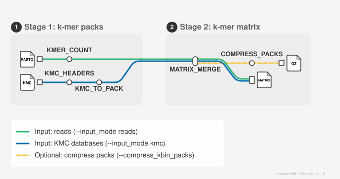

# kmer-gwas-cpp

**k-mer matrices for genome-wide association studies, from reads or KMC databases, at cohort scale.**

A high-performance Nextflow pipeline that builds the k-mer matrix for a GWAS: one row per k-mer, one column per accession. It does not run the association test itself. It supports SLURM, Singularity/Apptainer, Docker and Podman, paired-end FASTQ/FASTA input or pre-built KMC databases, presence/absence or count matrices, and bit-packed output.

> **Status:** Benchmark values refer to the rice dataset described in [`docs/BENCHMARKS.md`](docs/BENCHMARKS.md). Performance is hardware- and dataset-dependent.

## Contents

- [Overview](#overview)
- [Requirements](#requirements)
- [Quick start](#quick-start)
- [Input](#input)
- [Output](#output)
- [Parameters](#parameters)
- [Resuming a run](#resuming-a-run)
- [Execution profiles](#execution-profiles)
- [Running offline](#running-offline)
- [Matrix formats](#matrix-formats)
- [Utilities](#utilities)
- [Algorithm](#algorithm)
- [Performance guidance](#performance-guidance)
- [Repository structure](#repository-structure)
- [Citation and support](#citation-and-support)

## Overview

For each accession, Stage 1 counts canonical *k*-mers from paired sequencing reads, or takes them from an existing KMC database, and writes a self-indexed binary pack containing sorted k-mer slices. Stage 2 seeks directly to the corresponding slice in every pack and performs a k-way merge to produce the matrix.

The output contains one row per distinct k-mer and one column per accession. It can encode either presence/absence or per-accession k-mer counts for downstream association analysis.

### Pipeline stages

<picture>
  <source media="(prefers-color-scheme: dark)" srcset="docs/images/metro_map_dark.svg">
  
</picture>

1. **Stage 1 builds one pack per accession** from one of two inputs:
   - **KMER_COUNT** (reads mode, the default) streams the accession's paired read files (R1 and R2; FASTQ or FASTA, plain or gzip-compressed), counts canonical k-mers, and writes `<accession>.kbin`.
   - **KMC_TO_PACK** (`--input_mode kmc`) reads the accession's KMC database and writes the same `<accession>.kbin`.

   Both write the same pack format, so Stage 2 does not depend on the input.
2. **MATRIX_MERGE** processes bins in parallel, merges the sorted slices from all accession packs, applies the optional MAF filter, and writes compressed matrix files.

### Key features

- Two Stage 1 inputs: paired reads (FASTQ or FASTA, plain or gzip-compressed) or pre-built KMC databases.
- Canonical k-mers only: a k-mer and its reverse complement are counted as one k-mer, stored as the smaller of the two (A<C<G<T order).
- Any odd k-mer length from 15 to 63.
- Streaming input without loading complete read sets into memory.
- Configurable Stage 1 memory budgeting with spill-to-disk support.
- One self-indexed pack per accession instead of per-bin directory trees. Each pack records its accession, input, versions and statistics, and Stage 2 checks the accession.
- Stage 2 memory proportional primarily to the number of accessions.
- Runtime compilation with `-march=native` for the executing node.
- Runs on a local machine or on SLURM, with the host compiler or in a container (Singularity, Apptainer, Docker or Podman) that supplies GCC, zlib-ng and pigz.
- Presence/absence, raw-count, and bit-packed matrix output.
- Optional extraction of k-mers present in every accession.
- A run record (`run_manifest.txt`: parameters, code checksum, container, completion status) and per-accession statistics (`pack_stats.tsv`).
- Nextflow caching and `-resume` support.

### Benchmark and compatibility

On the rice benchmark, the new implementation produced **396,551,210 matrix rows**, compared with **396,551,209** for the previous implementation. The single additional row is the valid all-`A` k-mer, which the previous implementation incorrectly discarded because its nucleotide encoding conflated `A` with the ambiguous-base sentinel used for `N`. The difference is fully explained and reflects a correction in the new implementation.

K-mers composed entirely of `A` bases are valid and are retained. Only windows containing an actual non-ACGT character are skipped. Other benchmark measurements include 27.6 GB Stage 1 peak memory, less than 0.1 GB Stage 2 peak memory, two Stage 1 filesystem entries per job, and 531 million k-mers per second encoder throughput.

## Requirements

| Component | Requirement |
|---|---|
| Nextflow | 25.10 or later, DSL2 |
| nf-schema plugin | Nextflow downloads it on the first run. For nodes with no internet access, see [Running offline](#running-offline). |
| Container engine: Singularity, Apptainer, Docker or Podman | Optional. Supplies GCC 12, zlib-ng and pigz. |
| SLURM | Required for the `slurm` profile |
| GCC 12 or later (C++17), zlib development files, pigz | Required when no container profile is used |

## Quick start

```bash
git clone https://github.com/mjfi2sb3/kmer-gwas-cpp.git
cd kmer-gwas-cpp
cp accessions.txt.example accessions.txt
# Edit accessions.txt: one accession ID per line.
```

Run the recommended profile:

```bash
nextflow run main.nf \
    -profile slurm,singularity \
    --accessions_file accessions.txt \
    --kmer_size 51 \
    --data_dir /path/to/fastq
```

Results are written to `./results` by default. Display all options with:

```bash
nextflow run main.nf --help
```

For clusters requiring an account or partition:

```bash
nextflow run main.nf \
    -profile slurm,singularity \
    --accessions_file accessions.txt \
    --kmer_size 51 \
    --data_dir /path/to/fastq \
    --clusterOptions='--account=myproject --partition=highmem'
```

## Input

### Accession file

The accession file is plain text with one identifier per line. Blank lines are ignored, and identifiers must match the prefixes of the read files.

```text
SAMPLE1_SRR0000001
SAMPLE2_SRR0000002
SAMPLE3_SRR0000003
```

### Read files

Paired-end files must follow this pattern:

```text
<accession>_1.fq[.gz]       # R1
<accession>_2.fq[.gz]       # R2
```

The pipeline supports `.fq`, `.fastq`, `.fq.gz`, and `.fastq.gz`. Compression is detected from file content. FASTA input, including single- and multi-line records, is also supported.

The first matching pair is selected in this order:

```text
_1.fq   _1.fastq   _1.fq.gz   _1.fastq.gz
_2.fq   _2.fastq   _2.fq.gz   _2.fastq.gz
```

If either mate is missing, the relevant accession job fails with an error identifying the accession.

### KMC databases

[KMC](https://github.com/refresh-bio/KMC) is a k-mer counter. For each sample it writes a database of two files that holds the sample's k-mers and their counts. With `--input_mode kmc`, Stage 1 uses these databases instead of reads. Use this mode when the k-mers were already counted with KMC: for example, when the reads are archived or no longer available, or to reuse existing KMC results.

Each accession needs one database in `--kmc_dir` (default: `--data_dir`):

```text
<accession>.kmc_pre
<accession>.kmc_suf
```

```bash
nextflow run main.nf \
    -profile slurm,singularity \
    --accessions_file accessions.txt \
    --input_mode kmc \
    --kmc_dir /path/to/kmc_dbs
```

Both input modes write the same pack format, so Stage 2 and the matrices do not change. KMC does not need to be installed: the pipeline includes the KMC 3.2.4 API and reads the database files directly (KMC1 and KMC2 formats).

**k-mer length.** KMC fixes the k-mer length when it builds a database. The pipeline reads it from the first accession's database, so `--kmer_size` is optional. If you give `--kmer_size`, it must be the same as in the database, or the run stops. A database with a different k-mer length from the others fails its job. To use a different k-mer length, build new databases from the reads with KMC (`kmc -k<k>`). A database cannot be converted to another k-mer length.

**KMC build options.** The options used to build a database change what the pipeline receives:

| KMC option | In KMC | In this pipeline |
|---|---|---|
| `-ci<n>` | Removes k-mers seen fewer than *n* times | This is the count filter for the accession. `--min_kmer_count` is applied in addition only when it is larger than *n*. If no k-mer reaches it, the job stops. |
| `-cx<n>` | Removes k-mers seen more than *n* times | These k-mers are absent from the accession. |
| `-cs<n>` | Stores counts up to *n* | Higher counts are stored as *n*. Presence/absence matrices are not affected. Count matrices (`--keep_kmer_counts y`) show at most *n*. |
| `-cs1`, or `kmc_tools compact` | Keeps the k-mers but no counts | Presence/absence matrices are correct. In a count matrix every value is 1, so use these databases for presence/absence only. |
| `-b` | Counts each strand separately (non-canonical k-mers) | The pipeline joins each k-mer with its reverse complement and adds their counts. With `-ci` greater than 1, a k-mer whose count was split between the two strands can be missing. The job writes a warning. |

**Consistency check.** Before any conversion, the pipeline reads every database header and writes `kmc_databases.tsv`. It has one row per accession: k-mer length, `-ci`, `-cx`, counter size, format and number of distinct k-mers. The run stops if the databases differ in k-mer length, `-ci` or `-cx` (or in counter size with `--keep_kmer_counts y`), because the accessions would then be filtered differently. `--kmc_allow_mixed true` changes this to a warning. A `--min_kmer_count` equal to or larger than every database's `-ci` applies one filter to all accessions, so different `-ci` values are then accepted.

## Output

```text
results/
├── run_manifest.txt
├── pack_stats.tsv
├── kmc_databases.tsv          (kmc mode)
├── bin/
│   ├── bits_to_text
│   └── kbin_dump
├── kmer_count_k<k>/
│   └── <accession>.kbin
├── matrix/
│   └── matrix_acc<N>_k<k>_bins<B>_minOcc<t>_<mode>_delim-<d>/
│       ├── <bin>_matrix.tsv.gz
│       └── <bin>_core.txt.gz
└── reports/
    ├── timeline.html
    ├── report.html
    └── dag.svg
```

The core-k-mer file is produced only when `--write_core_kmers true` is enabled. The k-mer length appears in output directory names so results produced with different values of `k` are not accidentally mixed.

Each `.kbin` file contains sorted bin slices and an index for direct seeking. Packs are uncompressed during processing and can optionally be compressed after both stages with `--compress_kbin_packs true`.

Each pack also records its metadata: the accession, the input mode (`reads` or `kmc`), the count filter and its source, the pipeline and KMC API versions, and statistics. `kbin_dump --info` prints the metadata of one pack, and the log shows a short summary when Stage 1 finishes. Stage 2 stops if a pack's recorded accession differs from its file name (`--skip_accession_check true` allows this).

`pack_stats.tsv` lists the metadata of every pack: one row per accession, in the order of the accession file, with the same columns in both input modes. A column that does not apply to a mode contains `NA`.

| Columns | Meaning |
|---|---|
| `accession`, `input_mode`, `created_by` | The accession; `reads` or `kmc`; the program that wrote the pack (`kmer_count` or `kmc_to_pack`) |
| `pipeline_version`, `kmc_api_version` | The versions used (`kmc_api_version` is `NA` in reads mode) |
| `kmer_size`, `canonical_kmers`, `num_bins` | The pack layout |
| `min_kmer_count`, `min_kmer_count_source` | The count filter, and where it came from: `default` or `given` (reads mode), `database` (the database's own `-ci`), or `enforced` (`--min_kmer_count` is larger than the database's `-ci`) |
| `count_limit`, `kmers_at_count_limit` | The largest count the input can store, and the number of k-mers at that count. The limit is 65535 in reads mode. For a KMC database it depends on the counter size in the database: 65535 for 2 bytes or more, 255 for 1 byte, and 1 for no counter. For 1 byte, 255 is an upper limit, because KMC does not record a smaller `-cs`. |
| `input_reads`, `input_bases`, `skipped_kmers_non_acgt` | The reads and bases read, and the k-mer positions skipped because they contain a base other than A, C, G or T (reads mode only) |
| `distinct_kmers_before_filter`, `distinct_kmers_after_filter` | The number of distinct k-mers before and after the count filter |
| `kmer_occurrences_after_filter` | The sum of the counts of the kept k-mers |
| `max_count_per_kmer` | The largest count of one k-mer |
| `estimated_kmer_coverage` | The count that has the most distinct k-mers, after the low-count peak of sequencing errors. K-mers at `count_limit` are not used. `NA` if there is no such peak. |
| `kmers_in_smallest_bin`, `kmers_in_largest_bin` | The number of k-mers in the smallest and the largest bin (bin balance) |

`run_manifest.txt` records how the results directory was made: the parameters, the command line, the profile with its executor and container engine, the container image, and the CPUs and memory each stage requested. A setting that the profile does not use shows `n/a`, for example the time limits with the `local` executor. The manifest also records a `code_checksum`. The checksum is one MD5 over `main.nf`, `nextflow.config`, `nextflow_schema.json`, `conf/`, `modules/` and the C++ sources, so two runs used the same code only if their checksums are the same. The manifest is written at launch with `status = running`, and a completion section (status, duration, CPU hours, task counts and, on failure, the error) is added when the run ends.

## Parameters

All parameters are checked at launch against `nextflow_schema.json`. An unknown parameter, for example a typo, or an invalid value stops the run before any job starts, and the error lists each invalid value.

| Parameter | Default | Description |
|---|---:|---|
| `--accessions_file` | `./accessions.txt` | Accession list. |
| `--input_mode` | `reads` | Stage 1 input: `reads` (FASTQ/FASTA) or `kmc` (KMC databases). |
| `--data_dir` | `./data` | Directory containing read files. |
| `--kmc_dir` | `--data_dir` | Directory containing KMC databases (`--input_mode kmc`). |
| `--kmc_allow_mixed` | `false` | kmc mode: warn instead of stopping when the databases were built with different `-ci`, `-cx` or counter sizes. |
| `--skip_accession_check` | `false` | Allow packs whose recorded accession differs from their file name. |
| `--output_dir` | `./results` | Output directory. |
| `--kmer_size` | none | Odd k-mer length from 15 to 63. Required with `--input_mode reads`. With `--input_mode kmc`, read from the databases. |
| `--num_bins` | `1500` | Number of k-mer bins and Stage 2 output shards. |
| `--min_kmer_count` | `2` (reads mode) | Discard k-mers observed fewer than this many times within an accession. In kmc mode, the databases are kept as they are (their own `-ci` applies); a larger value is enforced as well. |
| `--threshold` | `0` | Two-sided minor-allele-frequency filter expressed as an accession-count threshold. |
| `--keep_kmer_counts` | `n` | `n` for presence/absence; `y` for raw per-accession counts. |
| `--encoding` | `text` | `text` or `bits`; bit encoding is for presence/absence only. |
| `--delimiter` | `none` | Text value delimiter: `none`, `tab`, or `space`. |
| `--write_core_kmers` | `false` | Write k-mers present in every accession to a separate file. |
| `--kmer_count_cpus` | `32` | CPUs and worker threads per KMER_COUNT job. |
| `--matrix_merge_cpus` | `16` | Threads used by MATRIX_MERGE. |
| `--kmer_count_memory` | `128.GB` | Scheduler memory request per KMER_COUNT and KMC_TO_PACK job. |
| `--kmer_count_budget_gb` | `0` | Stage 1 accumulation budget. `0` uses 70% of the task's memory limit: the SLURM job limit with `slurm`, or the task's memory request (`--kmer_count_memory`) with `local`. |
| `--kmer_count_read_threads` | `2` | Concurrent read/decompression threads. |
| `--matrix_merge_memory` | `16.GB` | Memory request per MATRIX_MERGE job. |
| `--kmer_count_time` | `5h` | Wall-clock limit per KMER_COUNT and KMC_TO_PACK job. |
| `--matrix_merge_time` | `10h` | Wall-clock limit per MATRIX_MERGE job. |
| `--cleanup` | `false` | Remove the Nextflow work directory after successful completion. |
| `--kmer_count_publish_mode` | `link` | Publish Stage 1 packs using `link`, `copy`, or `move`. |
| `--matrix_publish_mode` | `link` | Publish Stage 2 matrices using `link`, `copy`, or `move`. |
| `--compress_kbin_packs` | `false` | Compress published `.kbin` files after both stages finish. |
| `--clusterOptions` | none | Additional SLURM options passed to jobs. |
| `--queue_size` | `200` | Maximum queued and running jobs submitted by SLURM. |
| `--max_retries` | `2` | Extra attempts for a job that failed because it ran out of memory or time (`slurm` only). Each attempt gets the base memory and time multiplied by the attempt number. `0` disables retries. |
| `--max_cpus` | `64` | Largest CPU request for one job. With `local`, also the most CPUs the run uses. |
| `--max_memory` | `512.GB` | Largest memory request for one job. With `local`, also the most memory the run uses. |
| `--max_time` | `24h` | Largest time limit for one job (`slurm` only). |
| `--singularity_cache_dir` | `./.singularity` | Singularity/Apptainer image cache directory. |

Because `--clusterOptions` begins with a hyphen, use the equals form:

```bash
--clusterOptions='--account=myproject --partition=highmem'
```

Most parameters can also be set in a config file given with `-c`. `--max_retries`, `--queue_size`, `--max_cpus`, `--max_memory`, `--max_time` and `--clusterOptions` are read before that file is applied, so set them on the command line or in a `-params-file`.

### K-mer length

`--kmer_size` must be odd and between 15 and 63. It is required in reads mode. In KMC mode, it is read from the databases. It is compiled into the C++ programs at the beginning of each job. Values up to 32 fit in one 64-bit word, reducing each Stage 1 record from 18 to 10 bytes. Changing `k` invalidates existing bin files; use a new `--output_dir`.

### MAF threshold

`--threshold` is a **two-sided minor-allele-frequency (MAF) filter expressed as an accession-count threshold**. It filters on the number of accessions carrying a k-mer, not on the number of times that k-mer occurs within an individual accession.

For a k-mer present in `c` of `N` accessions, it is retained when:

```text
threshold ≤ c ≤ N − threshold
```

The corresponding binary k-mer MAF is:

```text
min(c / N, 1 − c / N)
```

Thus, the filter requires MAF to be at least `threshold / N`. For example, with 100 accessions, `--threshold 20` retains k-mers present in at least 20 and at most 80 accessions. The default, `--threshold 0`, disables the filter. The within-accession count filter is controlled separately by `--min_kmer_count`.

### Matrix encoding

The k-mer in each row is canonical. The k-mer is separated from the values by a tab. `--delimiter` controls the separator between values in text encoding.

| Encoding | Counts | Delimiter | Example |
|---|---|---|---|
| `text` | `n` | `none` | `KMER<TAB>101` |
| `text` | `n` | `tab` | `KMER<TAB>1<TAB>0<TAB>1` |
| `text` | `y` | `tab` or `space` | `KMER<TAB>5<TAB>0<TAB>3` |
| `bits` | `n` | ignored | `KMER<TAB>05` in hexadecimal |

`bits` and `none` require presence/absence output. Bit-packed rows store one bit per accession and are approximately eight times smaller than tab-delimited presence/absence rows at large cohort sizes.

## Resuming a run

Nextflow can reuse completed tasks only while the relevant task cache and work-directory files remain available. The two publishing parameters control this independently for the two pipeline stages.

The recommended settings are `--kmer_count_publish_mode link` and `--matrix_publish_mode link`, provided that `--output_dir` and the Nextflow work directory are on the same filesystem. Hard links avoid unnecessary data copies while retaining the work-directory files required for resumption.

Use `--kmer_count_publish_mode copy` and/or `--matrix_publish_mode copy` when the output and work directories are on different filesystems. This preserves resumability for the corresponding stage but requires an additional copy of the published data.

Use `--kmer_count_publish_mode move` and/or `--matrix_publish_mode move` to minimise storage duplication when resumption is not required. However, `move` removes the corresponding published output from the task work directory: `--kmer_count_publish_mode move` prevents reuse of completed KMER_COUNT tasks, while `--matrix_publish_mode move` prevents reuse of completed MATRIX_MERGE tasks.

To retain both caches required by `-resume`, use `--cleanup false` together with `link` or `copy` for both publishing modes. A successful run with `--cleanup true` cannot be resumed because the Nextflow work directory has been removed.

Example:

```bash
# Initial run
nextflow run main.nf \
    -profile slurm,singularity \
    --cleanup false \
    --kmer_count_publish_mode link \
    --matrix_publish_mode link \
    --accessions_file accessions.txt \
    --kmer_size 51 \
    --data_dir /path/to/fastq

# Resume after a failure or interruption
nextflow run main.nf \
    -profile slurm,singularity \
    -resume \
    --cleanup false \
    --kmer_count_publish_mode link \
    --matrix_publish_mode link \
    --accessions_file accessions.txt \
    --kmer_size 51 \
    --data_dir /path/to/fastq
```

## Execution profiles

Select one executor and, optionally, one container engine, separated by a comma:

| Executor | Runs tasks |
|---|---|
| `local` | On this machine. This is the default when no `-profile` is given. |
| `slurm` | As SLURM jobs, with time limits, and retries with more memory and time after an out-of-memory or time-out failure. |

| Container engine | Use |
|---|---|
| `singularity`, `apptainer` | HPC clusters |
| `docker`, `podman` | Workstations and cloud machines |
| (none) | The host supplies GCC 12 or later, zlib and pigz. |

```bash
-profile slurm,singularity     # HPC (recommended)
-profile local,docker          # workstation
-profile local                 # host compiler, small tests
```

The container image is published at `ghcr.io/mjfi2sb3/kmer-gwas-cpp:<version>`. It is a toolchain only: each job compiles the source in your checkout with `-march=native` inside the container. The image is built for x86-64; on an ARM computer (for example Apple silicon), Docker runs it slowly through emulation.

With `local`, the tasks share the CPUs and memory of the machine or of the SLURM allocation that runs Nextflow, capped at `--max_cpus` and `--max_memory`. A request larger than that runs with what is available.

A task starts only when its CPUs and memory are free in this pool. With the default `--kmer_count_cpus 32` on a machine with 32 CPUs, one accession runs at a time. `kmer_count` decompresses each input file with one thread, so a task does not always use all of its CPUs. To run two accessions at once, set `--kmer_count_cpus` to half the CPUs, for example `--kmer_count_cpus 16`. This needs memory for two tasks (2 × `--kmer_count_memory`); if there is not enough, the second task waits. This can finish more accessions per hour. The results do not change.

Resources per job:

| Process | CPUs | Memory | Time (`slurm` only) |
|---|---:|---:|---:|
| KMER_COUNT | `--kmer_count_cpus` (32) | `--kmer_count_memory` (128 GB) | `--kmer_count_time` (5 h) |
| KMC_TO_PACK | 2 | `--kmer_count_memory` | `--kmer_count_time` |
| MATRIX_MERGE | `--matrix_merge_cpus` (16) | `--matrix_merge_memory` (16 GB) | `--matrix_merge_time` (10 h) |
| COMPRESS_PACKS | `--matrix_merge_cpus` | 4 GB | `--matrix_merge_time` |

Every request is clamped to `--max_cpus`, `--max_memory` and `--max_time`.

## Running offline

Nextflow downloads the nf-schema plugin on the first run. If your compute nodes have no internet access, install the plugin before the run:

1. On a node that has internet access (for example, a login node), install the plugin once:

   ```bash
   nextflow plugin install nf-schema@2.7.3
   ```

   Nextflow puts the plugin in `$NXF_HOME/plugins`. The default `NXF_HOME` is `$HOME/.nextflow`.

2. Before `nextflow run` (for example, in your SLURM script), set:

   ```bash
   export NXF_OFFLINE=true
   ```

   Without this setting, Nextflow tries to contact the plugin registry, and the run stops with `Network is unreachable` in `.nextflow.log`.

Some clusters give the compute nodes a different home directory from the login node. Then the compute nodes do not find the plugin, and the run stops with `Cannot find the manifest path` or `Plugin with id nf-schema not found`. To prevent this, use one of these methods:

- Copy `.nextflow` from the login-node home to the compute-node home.
- Set `NXF_HOME` to the same shared directory for the install and for the run.

### Shaheen III (KAUST)

On Shaheen III, the home directory is `/home/$USER` on the login nodes and `/scratch/$USER` on the compute nodes. On a login node:

```bash
# Download the plugin to /home/$USER/.nextflow
nextflow plugin install nf-schema@2.7.3

# Copy it to the compute-node home (remove an old copy first)
rm -rf /scratch/$USER/.nextflow
cp -r /home/$USER/.nextflow /scratch/$USER/.nextflow
```

In your SLURM script, before `nextflow run`:

```bash
export NXF_OFFLINE=true
```

## Matrix formats and utilities

Convert between text and bit-packed representations with `bits_to_text`:

```bash
results/bin/bits_to_text --encode -i input_matrix.tsv -o output_bits.tsv
results/bin/bits_to_text --decode -n 10000 -i input_bits.tsv -o output_text.tsv
results/bin/bits_to_text --decode -n 10000 -i input_bits.tsv | pigz > output_text.tsv.gz
```

`kbin_dump` prints pack metadata or exports sorted k-mers:

```bash
results/bin/kbin_dump results/kmer_count_k51/SAMPLE1.kbin --info
results/bin/kbin_dump results/kmer_count_k51/SAMPLE1.kbin --bin 42
results/bin/kbin_dump results/kmer_count_k51/SAMPLE1.kbin --all_bins ./export
```

It requires an uncompressed pack. Decompress `.kbin.gz` files first:

```bash
pigz -dc SAMPLE1.kbin.gz > SAMPLE1.kbin
```

## Algorithm

### Stage 1: k-mer counting

For each accession, the pipeline streams paired FASTQ or FASTA reads, extracts canonical k-mers with a rolling encoder, and skips only windows containing non-ACGT characters. Valid all-`A` windows are retained. K-mers are partitioned into bins, accumulated within the configured memory budget, sorted and compacted, spilled when necessary, filtered by `--min_kmer_count`, and written as sorted slices to one `.kbin` pack.

### Stage 2: matrix construction

For each bin, the pipeline opens one streaming cursor per accession, seeks directly to the relevant slice, performs a heap-based k-way merge, emits one row per distinct k-mer, applies the optional two-sided MAF threshold, and formats values as text or hexadecimal bit-packed presence/absence. Core k-mers can be written as a separate output.

## Performance guidance

`--num_bins` primarily controls parallelism and output sharding. More bins reduce the amount of data handled by each MATRIX_MERGE job but increase the number of jobs and output files.

For large cohorts:

- Set `--kmer_count_budget_gb` explicitly when a predictable Stage 1 memory ceiling is required.
- Use `--kmer_count_publish_mode link` and `--matrix_publish_mode link` when output and work share a filesystem.
- Use `--encoding bits` when downstream tools support bit-packed data or conversion through `bits_to_text`.
- Retain `--cleanup false` until validation and any required resumption are complete.
- Increase `--queue_size` only if cluster policy permits more concurrent submissions.

## Repository structure

```text
.
├── main.nf
├── nextflow.config
├── nextflow_schema.json    # Parameter rules and descriptions
├── docs/
│   ├── BENCHMARKS.md
│   └── images/             # Metro map (metro_map.mmd is the nf-metro source)
├── conf/
│   ├── base.config
│   ├── local.config
│   ├── slurm.config
│   └── container.config
├── modules/
│   ├── kmer_count.nf
│   ├── kmc_headers.nf
│   ├── kmc_to_pack.nf
│   ├── matrix_merge.nf
│   ├── compress_packs.nf
│   └── build_tools.nf
├── src/
│   ├── kmer_count_v3.cpp
│   ├── kmc_to_pack.cpp
│   ├── kmc_api/            # KMC 3 API (GPL-3)
│   ├── matrix_merge.cpp
│   ├── bits_to_text.cpp
│   ├── kmer_key.hpp
│   ├── pack_io.hpp
│   ├── bin_store.hpp
│   ├── thread_pool.hpp
│   └── Makefile
├── tools/
│   ├── kbin_dump
│   ├── bits_to_text
│   ├── check_kmc_db.sh
│   ├── test_kmc_to_pack.sh
│   └── README.md
├── Dockerfile
├── .gitlab-ci.yml
└── accessions.txt.example
```

## Licence

The pipeline is released under the MIT licence (see `LICENSE`). The exception is
`src/kmc_api/` (the KMC 3.2.4 API, unmodified) and `src/kmc_to_pack.cpp`, which
links it: these files, and the `kmc_to_pack` binary built from them, are under
the GNU GPL 3. See `src/kmc_api/README`.

## Citation and support

If this pipeline contributes to published work, cite the associated software release and report the pipeline version, input mode (reads or KMC databases), k-mer length, `--threshold` MAF setting, `--min_kmer_count` (or the KMC databases' `-ci`), matrix encoding, execution profile, and relevant hardware or cluster configuration. `run_manifest.txt` records these values.

For usage information:

```bash
nextflow run main.nf --help
```

Please report reproducible issues with the command, profile, parameter values, input layout, Nextflow version, and relevant log or trace files.